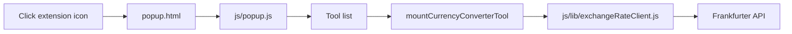

# Currency Converter Tool for dtp-os

Yes — this is straightforward. dtp-os already has a plug-in tool system: clicking the extension icon opens [`popup.html`](popup.html), which renders a tool list from `TOOL_DEFINITIONS` in [`js/popup.js`](js/popup.js). Each tool exports a `mount*Tool(container, { showToast, hideToast })` function. A currency converter fits this pattern exactly.

## Architecture



**Rate source:** [Frankfurter API](https://www.frankfurter.app/) — free, no API key, ECB-based daily rates. Single conversion call:

`GET https://api.frankfurter.app/latest?amount=100&from=USD&to=EUR`

Returns `{ amount, base, date, rates: { EUR: 92.34 } }`.

## Files to add / change

| File | Change |
|------|--------|
| [`js/toolSettings.js`](js/toolSettings.js) | Add `CURRENCY_CONVERTER: "currency-converter"` |
| [`js/lib/exchangeRateClient.js`](js/lib/exchangeRateClient.js) | **New** — `fetchCurrencies()`, `convert(amount, from, to)` |
| [`js/currencyConverter.js`](js/currencyConverter.js) | **New** — tool UI + mount function |
| [`js/popup.js`](js/popup.js) | Import mounter, register in `TOOL_DEFINITIONS` + `TOOL_MOUNTERS` |
| [`manifest.json`](manifest.json) | Add `host_permissions` for `https://api.frankfurter.app/*` |
| [`css/popup.css`](css/popup.css) | Minor layout for currency row + swap button (reuse existing `.tool-form-panel`, `.tool-input`, `.tool-label`) |

No changes to `popup.html` — the panel content is injected dynamically.

## Tool UI (simple v1)

Reuse the form-tool pattern from [`js/cloudflareDocker.js`](js/cloudflareDocker.js):

- **Amount** — number input (default `1`)
- **From** / **To** — `<select>` dropdowns populated from Frankfurter `/currencies`
- **Swap** — button to flip from/to and re-convert
- **Result** — read-only output showing converted amount + rate date
- **Error state** — inline `.tool-error` for invalid amount or network failure

Behavior:
- Fetch currency list once on mount
- Convert on `input` (amount) and `change` (currency selects), debounced ~300ms
- Disable controls while a fetch is in-flight; show toast on hard failures
- Default currencies: `USD` → `EUR` (sensible defaults; swap works either way)
- Return cleanup function that removes listeners and cancels pending debounce/abort

## API client design

[`js/lib/exchangeRateClient.js`](js/lib/exchangeRateClient.js):

```javascript
const BASE_URL = "https://api.frankfurter.app";

export async function fetchCurrencies() { /* GET /currencies → sorted [code, name] */ }
export async function convert(amount, from, to, signal) { /* GET /latest?amount=&from=&to= */ }
```

- Validate `amount > 0` before calling API
- If `from === to`, return amount unchanged (skip network)
- Use `AbortController` so rapid currency changes cancel stale requests

## Registration in popup router

In [`js/popup.js`](js/popup.js), add after existing tools:

```javascript
import { mountCurrencyConverterTool } from "./currencyConverter.js";

// TOOL_DEFINITIONS entry:
{ id: TOOLS.CURRENCY_CONVERTER, label: "Currency Converter", implemented: true }

// TOOL_MOUNTERS entry:
[TOOLS.CURRENCY_CONVERTER]: mountCurrencyConverterTool,
```

Place it after Emojis (utility tools grouped together) or before Settings — your preference; plan assumes after Cloudflare Docker.

## Manifest permission

Add to [`manifest.json`](manifest.json) `host_permissions`:

```json
"https://api.frankfurter.app/*"
```

Same pattern as the video downloader's AWS permissions. No new `permissions` entries needed beyond existing `storage` (not required for v1, but available if we later cache last-used currencies).

## CSS additions (minimal)

In [`css/popup.css`](css/popup.css), add a small flex row for the currency selects + swap button:

- `.currency-converter-row` — horizontal flex, gap, aligned selects
- `.currency-swap-btn` — compact icon/button between dropdowns (↔ or ⇄)
- `.currency-result` — reuse `.tool-output` styling for the converted value

Match existing hot-pink dark theme from popup styles.

## Test plan

1. Load unpacked extension, click toolbar icon → "Currency Converter" appears in list
2. Open tool → currency dropdowns populate (30+ currencies)
3. Enter `100`, USD → EUR → result updates with today's ECB date
4. Click swap → currencies flip, result recalculates
5. Set amount to `0` or empty → inline error, no API call
6. Disconnect network → error message shown gracefully
7. Back button / Escape returns to tool list without leaks (cleanup runs)

## Out of scope for v1

- Copy-to-clipboard, remembered currencies, offline cache (can add later)
- Custom/base API keys or paid rate providers
- Multi-target conversion (one amount → many currencies)
