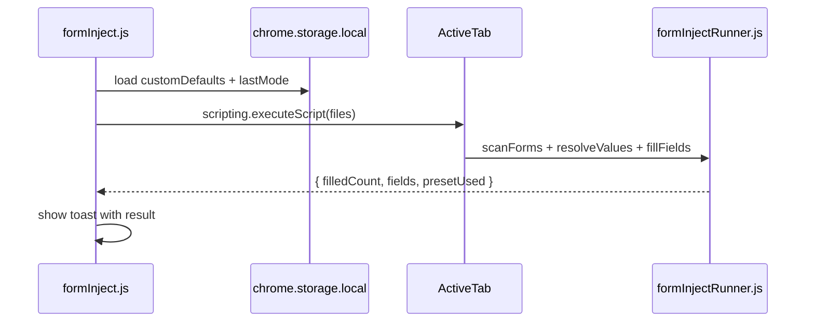

# Form Inject — dtp-os × clients-wendy-c

## Answer: dynamic form reading

**Yes.** A content script can scan the active page for `<form>` fields (`input`, `select`, `textarea`), read `name`, `id`, `type`, `autocomplete`, associated `<label>` text, and `<option>` lists, then generate plausible mock values from heuristics (email → `test+{timestamp}@example.com`, tel → `(555) 555-0100`, select → first non-empty option, etc.).

For **clients-wendy-c**, we also ship a **known preset** so `/contact` fills valid values that pass `[lib/intakeValidation.js](file:///Users/argo/Code/atos/clients-wendy-c/lib/intakeValidation.js)` without guessing select options.

**React note:** Wendy’s form is controlled (`value={form.name}` + `onChange`). Setting `.value` alone will not update React state. The injector must use the native value setter + bubble `input`/`change` events (standard pattern for React 17+ forms).

---

## Architecture




| Layer    | File                                                                                                                                           | Role                                                                       |
| -------- | ---------------------------------------------------------------------------------------------------------------------------------------------- | -------------------------------------------------------------------------- |
| Tool UI  | `[js/formInject.js](file:///Users/argo/Code/dtp/dtp-os/js/formInject.js)`                                                                      | Scan preview, Fill button, settings JSON editor                            |
| Settings | `[js/lib/formInjectSettings.js](file:///Users/argo/Code/dtp/dtp-os/js/lib/formInjectSettings.js)`                                              | Persist `formInjectCustomDefaults` + `formInjectLastMode`                  |
| Presets  | `[js/lib/formInjectPresets.js](file:///Users/argo/Code/dtp/dtp-os/js/lib/formInjectPresets.js)`                                                | Built-in Wendy intake preset + URL matchers                                |
| Engine   | `[js/lib/formInjectEngine.js](file:///Users/argo/Code/dtp/dtp-os/js/lib/formInjectEngine.js)`                                                  | Pure scan/generate/fill logic (imported by runner + popup preview helpers) |
| Runner   | `[js/content/formInjectRunner.js](file:///Users/argo/Code/dtp/dtp-os/js/content/formInjectRunner.js)`                                          | IIFE injected into page; calls engine, returns stats                       |
| Registry | `[js/popup.js](file:///Users/argo/Code/dtp/dtp-os/js/popup.js)`, `[js/toolSettings.js](file:///Users/argo/Code/dtp/dtp-os/js/toolSettings.js)` | Register `FORM_INJECT` tool                                                |


**Permissions** (`[manifest.json](file:///Users/argo/Code/dtp/dtp-os/manifest.json)`): add `"scripting"` and `"activeTab"` — no broad `<all_urls>` needed; injection runs only when the user clicks Fill/Scan from the popup (user gesture).

---

## Value resolution (priority order)

For each discovered field (matched by `name`, then `id`):

1. **Built-in site preset** — if URL matches a preset (see below)
2. **User custom defaults** — from Settings JSON in storage (`{ "name": "...", "email": "..." }`)
3. **Generic heuristics** — by `type`, `autocomplete`, and name/id/label keywords

### Built-in Wendy intake preset

Match when pathname contains `/contact` (works on `http://localhost:3000/contact` and production).


| Field `name`     | Mock value                            |
| ---------------- | ------------------------------------- |
| `name`           | `Alex Testpatient`                    |
| `email`          | `test.intake+{timestamp}@example.com` |
| `phone`          | `5405550100`                          |
| `age`            | `34`                                  |
| `serviceSeeking` | `Counseling`                          |
| `insuranceType`  | `Other`                               |
| `reason`         | Short generic reason under 1000 chars |


Uses `@example.com` addresses so accidental submits are clearly test data.

### Generic heuristics (fallback for unknown forms)


| Signal                                         | Generated value                              |
| ---------------------------------------------- | -------------------------------------------- |
| `type=email` or name/id/label contains `email` | `test+{timestamp}@example.com`               |
| `type=tel` or name contains `phone`            | `5555550100`                                 |
| `autocomplete=name` or name `name`             | `Jane Doe`                                   |
| name/id contains `age`                         | `32`                                         |
| `type=number`                                  | `42`                                         |
| `select`                                       | first `<option value>` that is non-empty     |
| `textarea`                                     | `This is test content for form development.` |
| `type=checkbox`                                | checked if required, else unchecked          |
| default text input                             | `Test value`                                 |


Skip: `type=hidden`, `type=submit`, `type=button`, disabled fields, and fields with `autocomplete="off"` on password fields.

---

## Popup UI (Form Inject tool)

Follow existing `.tool-form-panel` patterns (like `[js/cloudflareDocker.js](file:///Users/argo/Code/dtp/dtp-os/js/cloudflareDocker.js)` + settings textarea from `[js/settingsTool.js](file:///Users/argo/Code/dtp/dtp-os/js/settingsTool.js)`):

- **Scan** — inject runner in `scanOnly` mode; show field count + list (`name` / label / inferred type) in a small preview area
- **Fill form** — inject with full fill; toast: `"Filled 7 fields (Wendy intake preset)"` or `"Filled 5 fields (generic)"`
- **Mode toggle** (optional, persisted): `Auto` (preset → custom → generic) vs `Generic only`
- **Custom defaults** — collapsible JSON textarea + Save button; validated on save (must be object of string values); stored under `formInjectCustomDefaults` in `chrome.storage.local`
- Help text with example JSON:

```json
{
  "name": "Custom Name",
  "email": "me@example.com",
  "reason": "My custom test reason."
}
```

**Fill only** — never clicks submit (per your preference).

---

## clients-wendy-c collab (minimal)

Primary work is in **dtp-os** — no Wendy code changes required for v1 because fields already have stable `name` attributes and ids (`intake-name`, etc.).

Optional small Wendy-side improvements (can be a follow-up):

- Add `data-dtp-form="intake"` on the `<form>` in `[components/PatientInquiryForm.js](file:///Users/argo/Code/atos/clients-wendy-c/components/PatientInquiryForm.js)` for explicit preset matching
- Fix bug in `[lib/intakeValidation.js](file:///Users/argo/Code/atos/clients-wendy-c/lib/intakeValidation.js)`: `errors` is referenced but never declared (`const errors = {}` missing) — validation currently broken
- Add a short "Form Inject testing" note to `[docs/EMAIL.md](file:///Users/argo/Code/atos/clients-wendy-c/docs/EMAIL.md)`

---

## Implementation details

### `formInjectRunner.js` (injected script)

Because dtp-os has **no build step**, the runner is a standalone IIFE (or imports engine via `"type": "module"` in `executeScript` — Chrome MV3 supports `files: ["js/lib/formInjectEngine.js", "js/content/formInjectRunner.js"]` with module type). Prefer **two-file module injection** to avoid duplicating engine logic.

```js
// popup → tab
const [tab] = await chrome.tabs.query({ active: true, currentWindow: true });
const [{ result }] = await chrome.scripting.executeScript({
  target: { tabId: tab.id },
  files: ["js/lib/formInjectEngine.js", "js/content/formInjectRunner.js"],
});
```

Runner exports `scanForms()`, `fillForms({ customDefaults, mode })` and returns `{ filledCount, fields, presetId }`.

### React-safe setter (in engine)

```js
function setFieldValue(el, value) {
  if (el.tagName === "SELECT") { /* set selectedIndex or value */ }
  else {
    const proto = el instanceof HTMLTextAreaElement
      ? HTMLTextAreaElement.prototype
      : HTMLInputElement.prototype;
    const setter = Object.getOwnPropertyDescriptor(proto, "value")?.set;
    setter?.call(el, value);
    el.dispatchEvent(new Event("input", { bubbles: true }));
    el.dispatchEvent(new Event("change", { bubbles: true }));
  }
}
```

### Registration checklist

1. Add `FORM_INJECT: "form-inject"` to `[js/toolSettings.js](file:///Users/argo/Code/dtp/dtp-os/js/toolSettings.js)`
2. Import + register in `[js/popup.js](file:///Users/argo/Code/dtp/dtp-os/js/popup.js)` `TOOL_DEFINITIONS` + `TOOL_MOUNTERS`
3. Update `[docs/architecture.md](file:///Users/argo/Code/dtp/dtp-os/docs/architecture.md)` — first tool with `activeTab` + `scripting`

---

## Test plan

1. Reload extension in `chrome://extensions`
2. Run Wendy site: `npm run dev` → open `http://localhost:3000/contact`
3. Open dtp-os popup → Form Inject → **Scan** → expect 7 fields listed
4. **Fill form** → all fields populated, React state updated (type in a field to confirm it doesn't snap back)
5. Manually submit → SES receives email with test data (if env configured)
6. Edit custom defaults JSON → Save → Fill again → custom values override preset
7. Open an arbitrary site with a contact form → generic heuristics fill unknown fields
8. Confirm Fill does **not** submit the form

