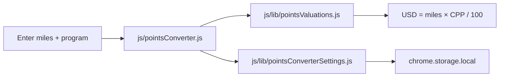

# Points Conversion Tool for dtp-os

Yes — this is a good fit for dtp-os, and **static values are the right approach**.

There is no reliable free API for airline-mile USD value. Airlines do not publish official valuations; sites like TPG and Upgraded Points maintain **editorial CPP tables** updated manually (roughly monthly). For a quick browser-popup utility, a bundled benchmark table is standard, works offline, and needs no `host_permissions`.

## Recommended approach



**Formula:** `usdEstimate = (miles × centsPerMile) / 100`

Example: 50,000 United miles @ 1.2¢ → **$600**

## v1 scope (per your choices)

- **US airline programs only**
- **Static estimate only** — program dropdown + miles input → rough USD
- Remember last program + miles (same pattern as currency converter)
- Clear disclaimer that values are planning estimates, not official

## Static valuation table

New file [`js/lib/pointsValuations.js`](js/lib/pointsValuations.js) — single source of truth:

| Program ID | Label | CPP (¢) |
|------------|-------|---------|
| `aa` | American AAdvantage | 1.7 |
| `ua` | United MileagePlus | 1.2 |
| `dl` | Delta SkyMiles | 1.2 |
| `wn` | Southwest Rapid Rewards | 1.4 |
| `as` | Alaska Atmos Rewards | 1.5 |
| `b6` | JetBlue TrueBlue | 1.4 |
| `f9` | Frontier miles | 0.9 |
| `nk` | Spirit Free Spirit | 0.9 |
| `ha` | HawaiianMiles | 1.2 |

Export:
- `POINTS_PROGRAMS` — sorted array of `{ id, label, centsPerMile }`
- `estimateUsd(miles, programId)` — pure function with validation

CPP values are rounded planning benchmarks aligned with common public valuations (TPG / Upgraded Points ballpark). Add a `lastUpdated` string in the file (e.g. `"2026-06"`) shown in the UI.

No manifest changes — fully client-side.

## Files to add / change

| File | Change |
|------|--------|
| [`js/toolSettings.js`](js/toolSettings.js) | Add `POINTS_CONVERTER: "points-converter"` |
| [`js/lib/pointsValuations.js`](js/lib/pointsValuations.js) | **New** — static US airline CPP table + `estimateUsd()` |
| [`js/lib/pointsConverterSettings.js`](js/lib/pointsConverterSettings.js) | **New** — `getLastPointsSet()` / `saveLastPointsSet()` via `chrome.storage.local` |
| [`js/pointsConverter.js`](js/pointsConverter.js) | **New** — `mountPointsConverterTool()` |
| [`js/popup.js`](js/popup.js) | Register in `TOOL_DEFINITIONS` + `TOOL_MOUNTERS` (after Currency Converter) |
| [`css/popup.css`](css/popup.css) | Reuse `.tool-form-panel`, `.currency-result`; add `.points-converter-note` for disclaimer |

## Tool UI

Mirror the currency converter layout from [`js/currencyConverter.js`](js/currencyConverter.js):

- **Miles** — number input (default `10000`)
- **Program** — `<select>` from `POINTS_PROGRAMS`
- **Estimated value** — formatted USD output (`Intl.NumberFormat`)
- **Rate line** — e.g. `Estimate @ 1.40¢ per mile · Updated Jun 2026`
- **Disclaimer** — small muted text: rough planning estimate; actual redemption value varies by route, cabin, and fees
- Instant recalc on `input` / `change` (no network, no debounce needed for math; debounce storage save ~300ms like currency tool)
- Return cleanup function removing listeners

Default program: `ua` (United) or restore from storage.

## Persistence

[`js/lib/pointsConverterSettings.js`](js/lib/pointsConverterSettings.js) — key `pointsConverterLastSet`:

```javascript
{ miles: "10000", programId: "ua" }
```

Load on mount; save on successful valid input (miles > 0).

## Registration

In [`js/popup.js`](js/popup.js):

```javascript
import { mountPointsConverterTool } from "./pointsConverter.js";

{ id: TOOLS.POINTS_CONVERTER, label: "Points Conversion", implemented: true }

[TOOLS.POINTS_CONVERTER]: mountPointsConverterTool,
```

## Test plan

1. Reload extension → **Points Conversion** appears in popup tool list
2. Enter `50000` + United → shows ~$600.00
3. Switch to Southwest → value updates using 1.4¢ CPP
4. Enter `0` or empty → inline error, no bogus result
5. Close and reopen tool → last miles + program restored
6. Works with network disabled (fully offline)

## Future extensions (out of scope)

- Award calculator (cash fare / taxes / miles → your CPM)
- Bank points (Chase UR, Amex MR)
- User-editable CPP overrides in settings
- Remote JSON fetch to refresh valuations (would need API source + permissions)
