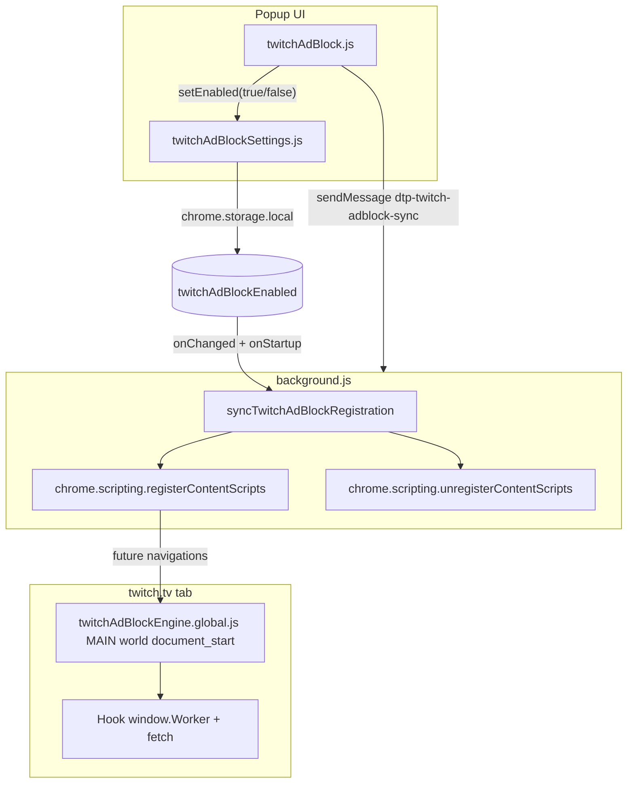

# TwitchAdBlock Tool — dtp-os Implementation Plan

## Problem and constraints

Twitch in-stream ads use **Server-Side Ad Insertion (SSAI)**: ads are stitched into the HLS stream on Twitch's servers, so they share the same delivery path as the video. That means:

- **DNS blockers (Pi-hole)** and **basic `declarativeNetRequest` rules** cannot block video ads without breaking playback
- **MV3 `webRequest` blocking** is deprecated and cannot do the dynamic M3U8 manifest manipulation Twitch ad blocking requires
- The proven free approach is a **page-context script at `document_start`** that hooks `window.Worker` and `fetch` before Twitch initializes — exactly what the **vaft** script does (MIT-licensed, [ryanbr/TwitchAdSolutions](https://github.com/ryanbr/TwitchAdSolutions))

**Upstream:** Use the actively maintained fork [ryanbr/TwitchAdSolutions](https://github.com/ryanbr/TwitchAdSolutions) (forked from the archived pixeltris repo). Pin to release **v68.4.0** (latest as of Jun 2026) when vendoring — not `master` — for reproducible builds.

**Important caveats to surface in the UI:**
- Twitch may change ad delivery; updates require re-vendoring from [ryanbr/TwitchAdSolutions releases](https://github.com/ryanbr/TwitchAdSolutions/releases)
- Users must **refresh open Twitch tabs** after toggling (worker hooks only run at page load)
- This is a new class of feature for dtp-os: **persistent, always-on** behavior when enabled (unlike Form Inject which runs on click)

---

## Architecture



**Enable flow:**
1. User opens TwitchAdBlock tool in popup → toggles "Block Twitch ads"
2. Popup saves `twitchAdBlockEnabled: true` to `chrome.storage.local`
3. Popup messages background → `syncTwitchAdBlockRegistration()`
4. Background calls `chrome.scripting.registerContentScripts()` with vaft engine, `world: "MAIN"`, `runAt: "document_start"`, `matches: ["*://*.twitch.tv/*"]`
5. New Twitch navigations get ad blocking; existing tabs need refresh

**Disable flow:** unregister content script by id; existing hooked tabs need refresh to fully stop.

---

## Files to create

| File | Purpose |
|------|---------|
| [`js/twitchAdBlock.js`](js/twitchAdBlock.js) | Popup tool UI: enable toggle, status, refresh hint |
| [`js/lib/twitchAdBlockSettings.js`](js/lib/twitchAdBlockSettings.js) | `getEnabled()` / `setEnabled()` via `chrome.storage.local` |
| [`js/lib/twitchAdBlockMeta.js`](js/lib/twitchAdBlockMeta.js) | Static vendored version + last-updated date (bump when re-vendoring) |
| [`js/lib/twitchAdBlockUpdateClient.js`](js/lib/twitchAdBlockUpdateClient.js) | On-demand GitHub releases API check |
| [`js/lib/twitchAdBlockRegistration.js`](js/lib/twitchAdBlockRegistration.js) | Shared register/unregister logic (importable from background + popup) |
| [`js/inject/twitchAdBlockEngine.global.js`](js/inject/twitchAdBlockEngine.global.js) | Vendored vaft logic (stripped userscript header, MIT attribution retained) |
| [`assets/tools/twitch-ad-block.svg`](assets/tools/twitch-ad-block.svg) | Tool icon |

## Files to modify

| File | Change |
|------|--------|
| [`js/toolSettings.js`](js/toolSettings.js) | Add `TWITCH_AD_BLOCK: "twitch-ad-block"` |
| [`js/toolIcons.js`](js/toolIcons.js) | Map id → icon path |
| [`js/popup.js`](js/popup.js) | Register in `TOOL_DEFINITIONS` + `TOOL_MOUNTERS` |
| [`manifest.json`](manifest.json) | Add `host_permissions` for `*://*.twitch.tv/*`; bump version |
| [`background.js`](background.js) | Startup sync, `onMessage` handler, `storage.onChanged` listener |
| [`docs/architecture.md`](docs/architecture.md) | Document new tool, permissions, and maintenance notes |

---

## Implementation details

### 1. Vendoring vaft

Source: `vaft/vaft.user.js` from [ryanbr/TwitchAdSolutions](https://github.com/ryanbr/TwitchAdSolutions) (MIT), pinned to tag **v68.4.0**:

```
https://raw.githubusercontent.com/ryanbr/TwitchAdSolutions/v68.4.0/vaft/vaft.user.js
```

Use the **userscript** variant (`vaft.user.js`), not `vaft-ublock-origin.js` — the uBlock build is for uBO's scriptlet runtime, not extension content scripts.

Adaptation steps:
- Copy into `js/inject/twitchAdBlockEngine.global.js`
- Remove userscript metadata block (`// ==UserScript==` …)
- Prepend a dtp-os header comment with upstream URL, release tag, and MIT attribution
- No functional changes for v1 — ship vaft as-is to maximize compatibility
- Bump constants in `twitchAdBlockMeta.js` whenever you re-vendor (see §6 below)

**Note:** vaft supports runtime `localStorage` config (e.g. `twitchAdSolutions_hideAdOverlay`, `twitchAdSolutions_playerType`) documented in the [ryanbr README](https://github.com/ryanbr/TwitchAdSolutions#configuration). v1 does not expose these in the dtp-os UI — users can set them in the Twitch tab console if needed. Optional v2: surface common options in the tool panel.

### 2. Dynamic content script registration

New shared module [`js/lib/twitchAdBlockRegistration.js`](js/lib/twitchAdBlockRegistration.js):

```javascript
const SCRIPT_ID = "dtp-twitch-ad-block";
const TWITCH_MATCHES = ["*://*.twitch.tv/*"];
const ENGINE_FILE = "js/inject/twitchAdBlockEngine.global.js";

export async function syncTwitchAdBlockRegistration(enabled) {
  await chrome.scripting.unregisterContentScripts({ ids: [SCRIPT_ID] }).catch(() => {});
  if (!enabled) return;
  await chrome.scripting.registerContentScripts([{
    id: SCRIPT_ID,
    js: [ENGINE_FILE],
    matches: TWITCH_MATCHES,
    runAt: "document_start",
    world: "MAIN",
    persistAcrossSessions: true,
  }]);
}
```

Call sites:
- `chrome.runtime.onInstalled` + `chrome.runtime.onStartup` in [`background.js`](background.js) — read storage, sync
- `chrome.storage.onChanged` — re-sync when `twitchAdBlockEnabled` changes from any surface
- Message `dtp-twitch-adblock-sync` from popup after toggle (belt-and-suspenders with `onChanged`)

**Why dynamic registration vs static `content_scripts` in manifest:**
- MAIN-world scripts cannot read `chrome.storage` synchronously at `document_start`
- Dynamic registration means **zero injection overhead when disabled** — script file never loads on Twitch

### 3. Manifest changes

[`manifest.json`](manifest.json):

```json
"host_permissions": [
  ...existing...,
  "*://*.twitch.tv/*",
  "https://api.github.com/*"
]
```

`scripting` permission already present. No `declarativeNetRequest` needed for v1 (user chose vaft-only).

### 4. Popup tool UI

Follow branding enable pattern from [`js/settingsTool.js`](js/settingsTool.js) (`branding-enable-row` checkbox):

[`js/twitchAdBlock.js`](js/twitchAdBlock.js) panel contents:
- **Description**: explains what is blocked (in-stream + overlays) and limitations
- **Enable checkbox**: "Block Twitch ads" — saves immediately on change (no separate Save button)
- **Status line**: "Active — refresh open Twitch tabs" / "Disabled"
- **Version footer** (always visible when tool is open):
  - `Engine: vaft v68.4.0`
  - `Last updated: Jun 6, 2026` (human-readable from `VENDORED_DATE`)
  - Link to [ryanbr/TwitchAdSolutions releases](https://github.com/ryanbr/TwitchAdSolutions/releases)
- **"Check for updates" button** — on-demand only (no network call on every open)

Settings persistence in [`js/lib/twitchAdBlockSettings.js`](js/lib/twitchAdBlockSettings.js):

```javascript
const STORAGE_KEY = "twitchAdBlockEnabled";
// default: false (opt-in)
```

### 5. Version metadata and update checking

**Why not only "Last updated"?** A date alone doesn't tell you if you're on the latest release. Show **both** version tag and date — version is what you compare against GitHub.

**Static metadata** — [`js/lib/twitchAdBlockMeta.js`](js/lib/twitchAdBlockMeta.js):

```javascript
export const TWITCH_AD_BLOCK_UPSTREAM =
  "https://github.com/ryanbr/TwitchAdSolutions";
export const VENDORED_VERSION = "v68.4.0";
export const VENDORED_DATE = "2026-06-06"; // ISO date you copied the file
```

Update both constants whenever you re-vendor vaft and reload the extension.

**On-demand update check** — [`js/lib/twitchAdBlockUpdateClient.js`](js/lib/twitchAdBlockUpdateClient.js):

```javascript
const RELEASES_URL =
  "https://api.github.com/repos/ryanbr/TwitchAdSolutions/releases/latest";

export async function checkForVaftUpdate() {
  const res = await fetch(RELEASES_URL);
  if (!res.ok) throw new Error("Could not reach GitHub.");
  const data = await res.json();
  const latest = data.tag_name; // e.g. "v68.4.0"
  const isNewer = compareSemver(latest, VENDORED_VERSION) > 0;
  return { latest, isNewer, releaseUrl: data.html_url };
}
```

`compareSemver` strips leading `v` and compares numeric segments.

**Button behavior** in tool panel:
1. User clicks "Check for updates"
2. Button shows loading state, disables briefly
3. On success:
   - Up to date → toast: "You're on the latest (v68.4.0)."
   - Update available → status line: "Update available: v68.5.0" + link opens release page (user must manually re-vendor + reload extension — no auto-update in v1)
4. On failure (offline, rate limit) → toast error, footer still shows static version/date

**No auto-check on open** — avoids unnecessary network calls and GitHub API rate limits; user controls when to check.

### 6. Background message handler

Extend [`background.js`](background.js) following the Form Inject message pattern:

```javascript
if (message?.type === "dtp-twitch-adblock-sync") {
  const enabled = message.enabled ?? await getTwitchAdBlockEnabled();
  await syncTwitchAdBlockRegistration(enabled);
  sendResponse({ ok: true });
  return true;
}
```

---

## UI registration checklist

Same pattern as Form Inject / Currency Converter:

1. `TOOLS.TWITCH_AD_BLOCK` in [`js/toolSettings.js`](js/toolSettings.js)
2. `{ id: TOOLS.TWITCH_AD_BLOCK, label: "Twitch Ad Block", implemented: true }` in [`js/popup.js`](js/popup.js) `TOOL_DEFINITIONS`
3. Import + mount in `TOOL_MOUNTERS`
4. Icon in [`js/toolIcons.js`](js/toolIcons.js) + SVG asset

---

## Testing plan

1. **Disabled by default** — load extension, visit twitch.tv, confirm no content script registered (`chrome.scripting.getRegisteredContentScripts()`)
2. **Enable** — toggle on in tool panel, navigate to a Twitch stream, verify preroll/midroll behavior (test on a channel known to serve ads)
3. **Disable** — toggle off, refresh tab, confirm ads return (validates unregister path)
4. **Persistence** — enable, restart browser, confirm registration survives (`persistAcrossSessions: true` + startup sync)
5. **Non-Twitch sites** — confirm no script injection on unrelated domains
6. **Playback stability** — watch 10+ minutes for buffering issues (vaft includes `monitorPlayerBuffering` for this)
7. **Version footer** — confirm version + last updated date render on tool open
8. **Check for updates** — button fetches GitHub API; shows up-to-date or update-available message with release link

---

## Risks and future maintenance

| Risk | Mitigation |
|------|------------|
| Twitch changes break vaft | Re-vendor from releases; bump `VENDORED_VERSION` + `VENDORED_DATE` in meta; user checks via button |
| Extension conflicts (7TV, Purple AdBlock, TTV-AB) | Document in tool UI per [upstream known conflicts](https://github.com/ryanbr/TwitchAdSolutions#known-extension-conflicts) |
| Toggle on open tabs | UI clearly says "refresh Twitch tabs"; optional v2: inject + warn if too late |
| MAIN world security | vaft is battle-tested; don't add chrome API calls in MAIN script |
| Twitch ToS | User-facing note that ad blocking may violate Twitch ToS; Turbo is the official ad-free option |

**v2 ideas (out of scope for v1):**
- Optional DNR layer for banner/display ads
- "Refresh all Twitch tabs" button when enabling
- Expose common vaft `localStorage` config options in tool panel (hide overlay, player type, etc.)
- One-click re-vendor script or in-extension update of engine file (complex; manual re-vendor is fine for now)
