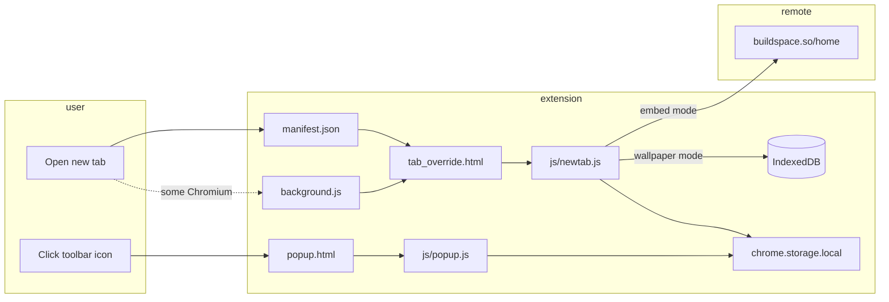

# dtp-os architecture

dtp-os is a **Manifest V3 browser extension** that replaces the browser’s default new tab page with a full-viewport page embedding an external web app. The repo lives under [oscoDOTblog/dtp-os](https://github.com/oscoDOTblog/dtp-os) and is derived from [buildspace/buildspace-os](https://github.com/buildspace/buildspace-os), with a background-script fix for Opera and other Chromium browsers that use a shared start page URL.

End-user install steps remain in the root [README.md](../README.md). This document describes how the extension works internally and how to customize or maintain it.

## High-level flow



| User action | What runs | Result |
|-------------|-----------|--------|
| Open a new tab (typical Chrome/Edge) | `tab_override.html` + `js/newtab.js` | Embed or wallpaper UI per saved `displayMode` |
| Click toolbar icon | `popup.html` + `js/popup.js` | Tool launcher list; pick a tool to open its panel |
| Right-click a page | `js/inject/copySectionEngine.global.js` via `background.js` | dtp-os menu copies the clicked section, main content, or whole page |
| Click the floating page button | `js/inject/copySectionEngine.global.js` | Copies main content in one click |
| Wallpaper mode, images saved | `pickRandomWallpaperId()` on load | Random full-viewport background |
| New tab via shared start page (`chrome://startpageshared/…`) | `background.js` listens and redirects | Same `tab_override.html` experience |

User guide for wallpapers: [wallpapers.md](./wallpapers.md).

## Repository layout

```
dtp-os/
├── manifest.json       # Extension metadata, permissions, new-tab override, toolbar popup
├── background.js       # Service worker: shared-start-page redirect
├── popup.html          # Toolbar popup shell (tool launcher + tool panels)
├── tab_override.html   # New tab shell (layers + controls)
├── css/
│   ├── tokens.css      # Shared Netflix-dark + hot pink design tokens
│   ├── newtab.css      # New tab layout and settings panel
│   ├── popup.css       # Toolbar popup layout and tools
│   ├── coss-button.css     # Vanilla coss Button variants/sizes
│   ├── coss-field.css      # Vanilla coss Field slots (label, description, group)
│   ├── coss-switch.css     # Vanilla coss Switch (preference toggles)
│   ├── coss-toggle-group.css # Vanilla coss ToggleGroup (segmented + 2x2 grid)
│   ├── emojiAutocomplete.css # In-page :query emoji picker overlay
│   └── copySection.css     # In-page copied-region outline + toast
├── js/
│   ├── lib/
│   │   ├── config.js                 # VIDEO_DL_API_URL (sway-sls Lambda)
│   │   ├── videodlClient.js          # Async video download API client
│   │   ├── youtubeChannelPlaylist.js # UC → UU playlist URL logic
│   │   ├── contentScriptRegistration.js # Idempotent dynamic content-script register/update
│   │   ├── formInjectDefaults.js     # Built-in mock values for common form fields
│   │   ├── formInjectSettings.js     # Profile + defaults persistence (chrome.storage.local)
│   │   ├── formInjectPresets.js      # Site-specific presets (e.g. Wendy intake)
│   │   ├── formInjectClient.js       # activeTab + scripting bridge for Form Inject
│   │   ├── twitchAdBlockSettings.js  # Twitch Ad Block enable flag (chrome.storage.local)
│   │   ├── bandcampStreamerSettings.js # Bandcamp Streamer enable flag + hotkey prefs (chrome.storage.local)
│   │   ├── bandcampStreamerRegistration.js # Dynamic ISOLATED-world loader registration
│   │   ├── twitchAdBlockMeta.js      # Vendored vaft version + last-updated date
│   │   ├── twitchAdBlockRegistration.js # Dynamic MAIN-world content script registration
│   │   ├── twitchAdBlockUpdateClient.js # On-demand GitHub release check
│   │   ├── emojiSearch.js            # Shared emoji query normalize/filter helpers
│   │   ├── emojiAutocompleteSettings.js # Emoji autocomplete enable flag (default on)
│   │   ├── emojiAutocompleteRegistration.js # Dynamic ISOLATED-world content script registration
│   │   ├── cossButton.js             # Vanilla coss Button factory
│   │   ├── cossField.js              # Vanilla coss Field composition helpers
│   │   ├── cossSwitch.js             # Vanilla coss Switch + switch-with-description field
│   │   ├── cossToggleGroup.js        # Vanilla coss single-select ToggleGroup
│   │   ├── copySectionSettings.js    # Copy Section enable flag + clipboard format
│   │   ├── copySectionRegistration.js # Dynamic content script + context menu registration
│   │   ├── copySectionClient.js      # activeTab + scripting bridge for the popup tool
│   │   ├── applyCopilotSettings.js   # CDP URL + relaunch script path (chrome.storage.local)
│   │   ├── videodlCookieSettings.js  # VideoDL loopback URL + auto-sync prefs
│   │   └── videodlCookieSync.js      # Netscape convert + loopback cookie upload
│   ├── inject/
│   │   ├── formInjectEngine.global.js # In-page scan/fill engine (injected via scripting)
│   │   ├── twitchAdBlockEngine.global.js # Vendored vaft engine (Twitch ad blocking)
│   │   ├── bandcampLoader.global.js # ISOLATED loader: reads prefs, injects MAIN-world bandcamp/init.js
│   │   ├── bandcamp/               # Vendored bandcamp-streamer page-world modules + CSS (incl. dtp-os-only modules/artist.js)
│   │   ├── emojiAutocompleteEngine.global.js # In-page :query emoji autocomplete
│   │   └── copySectionEngine.global.js # In-page region detection + Markdown serializer
│   ├── formInject.js        # Form Inject popup tool
│   ├── twitchAdBlock.js     # Twitch Ad Block popup tool
│   ├── copySection.js       # Copy Section popup tool
│   ├── bandcampStreamer.js     # Bandcamp Streamer popup tool (enable toggle + hotkey remap)
│   ├── bandcampStreamerSettingsPanel.js # Bandcamp toggle for Settings (popup + new tab)
│   ├── applyCopilotTool.js  # Apply Copilot CDP status + relaunch helper
│   ├── videodlCookiesTool.js # Push YouTube cookies to local VideoDL
│   ├── emojiAutocompleteSettingsPanel.js # Settings toggle UI for emoji autocomplete
│   ├── copySectionSettingsPanel.js # Settings toggle + format UI for Copy Section
│   ├── storage.js           # IndexedDB wallpaper blobs
│   ├── wallpapers.js        # CRUD, validation, mode + order in chrome.storage
│   ├── appSettings.js       # App name + custom greetings in chrome.storage
│   ├── defaultGreetings.js  # Built-in rotating new-tab messages
│   ├── settingsTool.js      # Settings / branding UI for popup and new tab
│   ├── newtab.js            # UI wiring, random background on load
│   ├── popup.js             # Popup router: tool list and navigation
│   ├── toolSettings.js      # Shared tool id constants
│   ├── emojis.js            # Emoji picker UI, search, copy-to-clipboard
│   ├── emojiData.global.js  # Classic script: globalThis.DTP_EMOJI_LIST (~1,300 entries)
│   ├── emoji-data.js        # ES module re-export of DTP_EMOJI_LIST for popup tools
│   ├── youtubePlaylist.js   # YouTube uploads playlist tool
│   ├── videoDownloader.js   # Video downloader tool (Lambda + S3 fetch)
│   └── cloudflareDocker.js  # Cloudflare docker run converter tool
├── assets/             # Extension icons (48, 128) and legacy logo
├── docs/               # Technical documentation
└── README.md           # End-user setup (load unpacked, developer mode)
```

There is no build step, bundler, or package manager. The extension is loaded **as-is** via “Load unpacked” in the browser.

### coss primitives in vanilla DOM

This repo has no React or Tailwind, so coss primitives are translated into plain DOM factories in `js/lib/coss*.js` with matching stylesheets in `css/coss-*.css`. Each factory sets the same `data-slot` attributes and state attributes that coss/Base UI emit (`data-slot="switch"`, `data-checked`, `data-pressed`, …), and the CSS selects on those slots rather than on bespoke class names, so markup stays recognisable against the coss docs.

| Primitive | Factory | Notes |
|---|---|---|
| Button | `createCossButton` | Variants and sizes mirror `@coss/button` |
| Field | `createCossField`, `createCossFieldLabel`, `createCossFieldDescription`, `createCossFieldGroup` | Label/description/control composition |
| Switch | `createCossSwitch`, `createCossSwitchField` | `role="switch"` button + thumb; used for binary preference toggles per coss guidance (Checkbox is reserved for consent / multi-select) |
| ToggleGroup | `createCossToggleGroup` | Single-select, `aria-pressed` items, roving arrow-key focus; `layout: "grid"` renders a 2×2 set |

Short option lists use ToggleGroup rather than a Select popup, following the coss Select guidance that very short lists with visible options are better served by an inline control. Because `button` is a labelable element, `FieldLabel htmlFor` targets Switch triggers directly; icon-only ToggleGroup items carry `aria-label` and the group is wired to its field label with `aria-labelledby`.

## Components

### `manifest.json`

- **Manifest version**: 3 (service worker background, no persistent background page).
- **Permissions**: `tabs`, `storage`, `scripting`, and `activeTab` (Form Inject on user gesture).
- **Host permissions**: `http://*/*` and `https://*/*` for emoji autocomplete content scripts; plus sway-sls video-download API Gateway and `*.amazonaws.com` for signed S3 download URLs; `*.twitch.tv` and GitHub for Twitch Ad Block.
- **New tab override**: `chrome_url_overrides.newtab` points at `tab_override.html`, which is the primary mechanism for replacing the new tab page.
- **Toolbar action**: `action.default_popup` points at `popup.html` for the browser-tools launcher.
- **Icons**: `assets/48.png` and `assets/128.png` for the extension listing and toolbar.

Display name and description are branded **dtp-os**.

### `tab_override.html`, `css/newtab.css`, `js/newtab.js`

The new tab page has three layers:

1. **`#backgroundLayer`** — cover-style background image (wallpaper mode).
2. **`#embedLayer`** — full-viewport `<iframe>` to `https://buildspace.so/home` (embed mode, default).
3. **`#controls`** — gear-toggle panel for upload, gallery, delete, and mode switch.

`js/newtab.js` runs on each new tab load: reads `displayMode` from `chrome.storage.local`, shows the correct layer, and in wallpaper mode calls `pickRandomWallpaperId()` then loads the blob from IndexedDB via `URL.createObjectURL`.

To point the embed at a different home, change the iframe `src` in `tab_override.html`.

### `popup.html`, `css/popup.css`, `js/popup.js`, tool modules

Clicking the toolbar icon opens a compact popup separate from the new tab page.

1. **Tool list** — Always shown when the popup opens. Emojis, YouTube Playlist, Video Downloader, VideoDL Cookies, Cloudflare Docker, Currency Converter, Points Conversion, Form Inject, Twitch Ad Block, Copy Section, Apply Copilot, Bandcamp Streamer (implemented); Colors (stub marked “Soon”).
2. **Emojis picker** — Search bar and scrollable emoji grid with client-side filter. Clicking an emoji copies it to the clipboard, shows a brief toast, then closes the popup.
3. **YouTube Playlist** — Paste channel page source, URL, or `UC...` ID; live-builds uploads playlist URL (`UC` → `UU`); copy and open in YouTube. Client-only (`js/lib/youtubeChannelPlaylist.js`).
4. **Video Downloader** — Paste a social URL; polls sway-sls Lambda (`js/lib/videodlClient.js`), then fetches the signed file and triggers a browser download.
5. **Cloudflare Docker** — Paste `docker run ...`; inserts `-d --restart unless-stopped` after `docker run`; copy converted command.
6. **Form Inject** — Scan or fill form fields on the active tab. Named mock-data profiles and fill mode are configured under **Settings** (popup or new tab gear → Form Inject); the popup can switch the active profile before fill. **Auto** fills only fields with a known profile/default/preset value and leaves unknowns blank; **Generic only** invents values for recognized field types (email, phone, name, …) but still skips free-text/essay questions and unrecognized fields.
7. **Twitch Ad Block** — Toggle in-stream and overlay ad blocking on `*.twitch.tv`. When enabled, registers a MAIN-world `document_start` content script with the vendored **vaft** engine from [ryanbr/TwitchAdSolutions](https://github.com/ryanbr/TwitchAdSolutions). Shows vendored version, last-updated date, and an on-demand “Check for updates” button against the GitHub releases API. Users must refresh open Twitch tabs after toggling.
8. **Emoji Autocomplete** (Settings) — On by default. When enabled, registers an ISOLATED-world `document_idle` content script on `http://*/*` and `https://*/*` that shows emoji suggestions while typing `:query` in native `input`/`textarea` fields. Toggle under **Settings** (popup or new tab). Refresh open tabs after toggling.
9. **Copy Section** — Copies a page region to the clipboard as Markdown (default) or plain text. Buttons for **Copy main content** and **Copy whole page** act on the active tab and show a character count plus a preview. In the page itself, a floating copy button sits in a configurable corner and a right-click menu (**dtp-os → Copy this section / Copy main content / Copy whole page**) covers the rest. Format, the right-click toggle, the button toggle, and the button corner live under **Settings**.
10. **VideoDL Cookies** — Reads YouTube/Google cookies from this Chrome profile (`chrome.cookies`, optional permission), converts them to Netscape format, and POSTs the file to local VideoDL at `http://127.0.0.1:8545/cookies/upload`. **Sync now** plus optional 6-hour auto-sync (`chrome.alarms`). Status shows reachability, last sync time, and cookie count — never cookie values. API URL must be loopback (`127.0.0.1` or `localhost`).
11. **Bandcamp Streamer** — Ports [bandcamp-streamer](https://github.com/aflowofcode/bandcamp-streamer) (vendored page-world code under `js/inject/bandcamp/`, upstream credit retained). When `bandcampStreamerEnabled` is true, registers an ISOLATED-world `document_idle` loader on `*://*.bandcamp.com/*` that reads hotkey prefs from `chrome.storage.local` and injects the MAIN-world player module — MAIN-world injection is required because the player drives Bandcamp's own page globals (`playerview`, `collectionPlayer`, `BCEvents`). Covers feed autoplay, collection/wishlist continuous play with shuffle/reverse/bulk-load, release-page hotkeys, a **dtp-os-only** artist-page player (`modules/artist.js`) that lazily fetches each release's embedded `data-tralbum` JSON for stream URLs and drives a native `Audio` element, and a **dtp-os-only** release-page bar (`modules/release.js`, shared `modules/bar.js`) driving the native player. Both bars share one dtp-tunes-style component with cover art, seek, volume, queue panel, and MP3 download (page-exposed stream URLs tagged with title/artist/album/year/track/cover in an offscreen extension document, with Chrome downloads handled by the service worker and a raw-stream fallback). The download button opens a small menu where a second "Whole album" entry (dtp-os-only, album pages only — not `/track/`) stages every tagged track in the offscreen document and returns them as one `Artist - Album.zip` (stored-entry zip built in-page from blob URLs, with the album cover included as `cover.jpg`); per-request results echo back to the page via a `reqId`, driving a spinning download button, status text, and a top-edge progress strip with byte-level percent — and (artist only) shuffle plus repeat off/all/one. Bandcamp's native collection player plus both bars are dark-themed after dtp-tunes with a light-mode toggle and selectable accent in the popup tool; hotkey remapping lives there too, and the enable toggle plus a download-button toggle (on by default; gates the bar's download button) also appear under Settings. Hotkey remapping lives in the popup tool; the enable toggle also appears under Settings. Styling parity with dtp-tunes (tokens, menus, buttons, sliders) is audited in `docs/dtp-tunes-parity.md`.

Each tool exports a `mount*Tool(container, { showToast, hideToast })` function; `js/popup.js` routes by tool id and runs cleanup when navigating back.

`js/toolSettings.js` exports shared tool id constants. `js/emojiData.global.js` ships a static curated emoji list (~1,300 entries) as `globalThis.DTP_EMOJI_LIST`; `js/emoji-data.js` re-exports it for ES module popup tools. `popup.html` loads the classic data script before the module entry.

### `js/storage.js` and `js/wallpapers.js`

| Store | Key / shape | Contents |
|-------|-------------|----------|
| IndexedDB `dtp-os` / `wallpapers` | `id` | `{ id, blob, mimeType, addedAt }` |
| `chrome.storage.local` | `displayMode` | `"embed"` \| `"wallpaper"` |
| `chrome.storage.local` | `wallpaperOrder` | `string[]` of IDs (gallery order) |
| `chrome.storage.local` | `copySectionEnabled` | `boolean` (default on) — right-click menu + floating button |
| `chrome.storage.local` | `copySectionFormat` | `"markdown"` \| `"plain"` |
| `chrome.storage.local` | `copySectionButtonEnabled` | `boolean` (default on) — floating button |
| `chrome.storage.local` | `copySectionButtonCorner` | `"bottom-left"` (default) \| `"bottom-right"` \| `"top-right"` \| `"top-left"` |
| `chrome.storage.local` | `videodlCookieSettings` | `{ videodlCookieApiUrl, videodlCookieAutoSync, videodlCookieIntervalMinutes }` |
| `chrome.storage.local` | `videodlCookieSyncState` | `{ lastSyncedAt, cookieCount, lastError, signedIn }` — no cookie values |

Upload rules: JPEG/PNG/WebP, max 5 MB per file, max 50 images. `syncWallpaperOrderWithDatabase()` reconciles the order array with IndexedDB on load.

### `background.js` (service worker)

ES module (`"type": "module"` in `manifest.json`). Responsibilities:

1. **Shared start page redirect** — Handles Chromium variants that initially open `chrome://startpageshared/` instead of going straight to the overridden new tab document.
2. **Twitch Ad Block sync** — On install, startup, `chrome.storage.onChanged`, and popup message `dtp-twitch-adblock-sync`, calls `syncTwitchAdBlockRegistration()` to register or unregister the vaft content script on `*.twitch.tv`.
3. **Emoji Autocomplete sync** — On install, startup, `chrome.storage.onChanged`, and message `dtp-emoji-autocomplete-sync`, calls `syncEmojiAutocompleteRegistration()` to register or unregister the ISOLATED-world `:query` picker on `http://*/*` / `https://*/*`. Enabled by default (`emojiAutocompleteEnabled !== false`).
4. **Form Inject relay** — Handles `dtp-form-inject` messages for tab script injection.
5. **Copy Section sync** — On install, startup, `chrome.storage.onChanged`, and message `dtp-copy-section-sync`, calls `syncCopySectionRegistration()` to register or unregister both the ISOLATED-world content script and the `chrome.contextMenus` items. Enabled by default (`copySectionEnabled !== false`).
6. **Copy Section menu handler** — `chrome.contextMenus.onClicked` maps the menu id to a mode (`section` / `main` / `page`), reads the saved format, then injects the engine into the clicked frame and runs it.
7. **VideoDL cookie sync** — Popup message `dtp-videodl-cookies-sync` collects allowlisted YouTube/Google cookies and uploads a Netscape file to the configured loopback VideoDL API. `dtp-videodl-cookies-alarm-sync`, install/startup, and `videodlCookieSettings` storage changes create or clear alarm `dtp-videodl-cookie-sync`. Auto-sync is off by default and never requests the optional `cookies` permission (that prompt is user-gesture only).

Shared start page flow:

1. On `chrome.tabs.onCreated`, if the new tab has **no URL yet** (`!tab.url`), register a one-shot-style handler on `chrome.tabs.onUpdated`.
2. When that tab’s URL updates, if it starts with `chrome://startpageshared/`, call `chrome.tabs.update(tab.id, { url: "tab_override.html" })`.

This logic was added to support **Opera and other Chromium browsers** (see commit `ba90754` in history). Standard Chrome new-tab override usually does not need this path but keeping it avoids a blank or wrong start page on those browsers.

**Implementation note for maintainers**: `onUpdated` listeners are registered inside `onCreated` without removal. Under heavy tab creation, duplicate listeners could accumulate. If that becomes an issue, refactor to a single global `onUpdated` handler that tracks pending tab IDs, or use `{ once: true }` patterns where the API allows.

## Permissions and security model

| Permission | Why |
|------------|-----|
| `tabs` | Read tab URL on create/update; redirect shared start page tabs to `tab_override.html` |
| `storage` | Persist `displayMode`, `wallpaperOrder`, and tool settings (e.g. Form Inject profiles, emoji autocomplete toggle) |
| `scripting` | Inject Form Inject engine into the active tab when the user clicks Scan or Fill; register dynamic content scripts |
| `activeTab` | Temporary access to the active tab for Form Inject |
| `contextMenus` | Copy Section: right-click menu on `http`/`https` pages |
| `clipboardWrite` | Copy Section: `document.execCommand("copy")` fallback in the page, since context-menu clicks carry no user activation |
| `alarms` | VideoDL Cookies: wake the service worker for optional 6-hour auto-sync |
| `optional_permissions` (`cookies`) | VideoDL Cookies: read YouTube/Google cookies after the user grants access on Sync / auto-sync enable |
| `host_permissions` (`http://*/*`, `https://*/*`) | Emoji Autocomplete: register ISOLATED-world content script when enabled (default on) |
| `host_permissions` (`http://127.0.0.1/*`, `http://localhost/*`) | VideoDL Cookies and Apply Copilot: loopback fetches |
| `host_permissions` (API Gateway + `*.amazonaws.com`) | Video Downloader: start/poll Lambda jobs and fetch signed S3 download URLs |
| `host_permissions` (`*://*.twitch.tv/*`) | Twitch Ad Block: register MAIN-world content script when enabled |
| `host_permissions` (`*://*.bandcamp.com/*`) | Bandcamp Streamer: register ISOLATED-world loader + inject MAIN-world player module and CSS when enabled |
| `host_permissions` (`https://api.github.com/*`) | Twitch Ad Block: on-demand check for newer vaft releases |

Form Inject uses `chrome.scripting.executeScript` with `js/inject/formInjectEngine.global.js` only when the user invokes Scan or Fill from the popup. It does not register persistent content scripts.

Dynamic content scripts (Emoji Autocomplete, Twitch Ad Block, Copy Section) use `js/lib/contentScriptRegistration.js`: `getRegisteredContentScripts` → `updateContentScripts` when the id already exists (common after reload with `persistAcrossSessions`), otherwise `registerContentScripts`, with a fallback to update on duplicate-id races. Each script id is serialized through a queue.

**Twitch Ad Block** uses `chrome.scripting.registerContentScripts` (not static manifest `content_scripts`) so the vaft engine is injected only when `twitchAdBlockEnabled` is true. The script runs in the page **MAIN** world at `document_start` to hook Twitch Web Workers before the player initializes. Vendored from `ryanbr/TwitchAdSolutions` tag `v68.4.0`; bump `VENDORED_VERSION` and `VENDORED_DATE` in `js/lib/twitchAdBlockMeta.js` when re-vendoring `js/inject/twitchAdBlockEngine.global.js`.

**Copy Section** uses the same dynamic registration pattern, registering the engine in the **ISOLATED** world at `document_idle` on all frames of `http`/`https` pages plus a `chrome.contextMenus` group. The persistent script exists only to record the `contextmenu` event target, which the menu-click handler needs to know *which* element was right-clicked — `contextMenus.onClicked` does not report it. On a tab loaded before the feature was enabled there is no recorded target, so **Copy this section** degrades to main-content detection until the tab is refreshed.

Region detection is a dependency-free heuristic in three tiers: semantic landmarks (`main`, `[role="main"]`, `article`, then common content ids and classes), a Readability-style score over the parents of text-bearing blocks, and finally `document.body`. Extraction strips `nav`/`header`/`footer`/`aside`, hidden elements, and containers whose id, class, or role matches known page furniture — except the region the user explicitly pointed at. Output is Markdown by default (headings, lists, links, code fences, blockquotes, tables, images) or plain text.

The copied region keeps a hot pink outline so it stays identifiable after the toast fades. The outline is cleared only by the next copy in that document or by a reload — never on a timer — and uses `outline` / `outline-offset`, which do not affect page layout.

The floating copy button and the toast render inside a **shadow root** on a single host element appended to `document.documentElement`, so the host page's stylesheet cannot restyle them and our rules cannot leak onto the page. The host carries inline `!important` positioning so page CSS cannot hide or move it, and it is `pointer-events: none` except for the button itself. Only `css/copySection.css` stays in the page stylesheet, because the highlight rule has to target a page element.

The button appears only in the top frame, and only when both `copySectionEnabled` and `copySectionButtonEnabled` are set. The engine reads those from `chrome.storage.local` directly and listens for `chrome.storage.onChanged`, so toggling the button or changing its corner takes effect in open tabs without a refresh. Clicking it copies main content; because that is a genuine in-page click it carries user activation, so `navigator.clipboard.writeText()` succeeds without the `execCommand` fallback.

Clipboard writes take the reliable path per caller: the popup receives the extracted text and calls `navigator.clipboard.writeText()` itself, where the button click supplies user activation. The context-menu path must write from the page, so it tries `navigator.clipboard.writeText()` and falls back to a hidden-textarea `document.execCommand("copy")`.

**Emoji Autocomplete** uses the same dynamic registration pattern. When `emojiAutocompleteEnabled` is not `false` (default on), registers `js/emojiData.global.js` + `js/inject/emojiAutocompleteEngine.global.js` with `css/emojiAutocomplete.css` in the **ISOLATED** world at `document_idle` on top-frame `http`/`https` pages. v1 watches native `input`/`textarea` only (not `contenteditable`). Users must refresh open tabs after toggling.

**Apply Copilot** is a popup-only helper for the CV Apply Copilot agent (`dtp-yui`). It probes `http://127.0.0.1:9222/json/version` (or a saved CDP URL), shows Ready / Not listening, and copies a Terminal command to run `relaunch-chrome-cdp.sh` so the user’s **daily Chrome profile** restarts with `--remote-debugging-port`. The extension cannot enable remote debugging on an already-running Chrome process (no `nativeMessaging` / `chrome.debugger` in this pass). Settings (`applyCopilotCdpUrl`, script path) live under `applyCopilotSettings` in `chrome.storage.local`.

**VideoDL Cookies** is a popup-only helper for local `dtp-videodl`. Cookie values are never logged, never shown in the UI, and are POSTed only to a validated loopback VideoDL origin (`http://127.0.0.1` or `http://localhost`). The optional `cookies` permission is requested on the user’s first Sync or auto-sync enable so other tools keep working if it is declined.

Other popup tools remain clipboard-only or fetch remote APIs. Risk surface includes: embedded iframe content, tab URL inspection in the service worker, locally stored user images in IndexedDB, clipboard writes from popup tools (user-initiated), outbound `fetch` to the video-download API when the user starts a download, DOM writes to form fields on the active tab when Form Inject is used, page-context script injection on Twitch when Twitch Ad Block is enabled, reading/writing text in focused form fields when Emoji Autocomplete is enabled, and (after optional grant) reading YouTube/Google cookies to push them to local VideoDL.

Users must **keep** the extension’s new-tab override when prompted (“page was changed by … extension”); declining disables the override.

## Browser support

| Environment | Notes |
|-------------|--------|
| Chrome / Edge (Chromium) | Documented in README; `chrome_url_overrides` + optional shared-start redirect |
| Opera / other Chromium | Relies on `background.js` redirect from `chrome://startpageshared/` |
| Firefox | Uses different extension APIs; this manifest is Chrome-oriented and is not validated for Firefox |

## Customization checklist

1. **Home URL** — Edit iframe `src` in `tab_override.html`.
2. **Branding** — Set app name and optional custom greetings (JSON array) via the center **Settings** modal on the new tab (gear icon) or **Settings** in the toolbar popup. Empty greetings use 105 built-in rotating messages. Update `name`, `description`, and icons in `manifest.json` for the extension listing itself.
3. **Styling** — Edit `css/newtab.css` (background layer, controls panel).
4. **Shared start page** — If a browser uses a different internal URL prefix, extend the `startsWith(...)` check in `background.js`.

## Testing locally

1. Enable **Developer mode** in the browser’s Extensions page.
2. **Load unpacked** and select the `dtp-os` directory (folder must contain `manifest.json`).
3. Open a **new tab** and confirm the prompt to keep the extension’s new tab page.
4. Click the **toolbar icon** and confirm the popup opens to the tool list every time.
5. On Opera or a browser that uses the shared start page, confirm redirect to the iframe page (watch service worker logs in the extension’s “Inspect views: service worker” if needed).

There are no automated tests in this repo.

## Relationship to DTP

The **dtp** parent folder also contains projects such as `dtp-videodl` (desktop/web tooling). **dtp-os** is separate: a lightweight browser shell for a fixed “home” URL on every new tab, not a Node/Python app. The VideoDL Cookies tool is the one cross-link: it can push this Chrome profile’s YouTube cookies to a loopback VideoDL API. Renaming or repointing the embedded URL is the main way to align this extension with DTP or osco branding without changing extension architecture.

## References

- [Chrome extension manifest — `chrome_url_overrides`](https://developer.chrome.com/docs/extensions/reference/manifest/chrome-url-overrides)
- [Manifest V3 service workers](https://developer.chrome.com/docs/extensions/mv3/service_workers/)
- Upstream user guide: [buildspace-os README](https://github.com/buildspace/buildspace-os)
